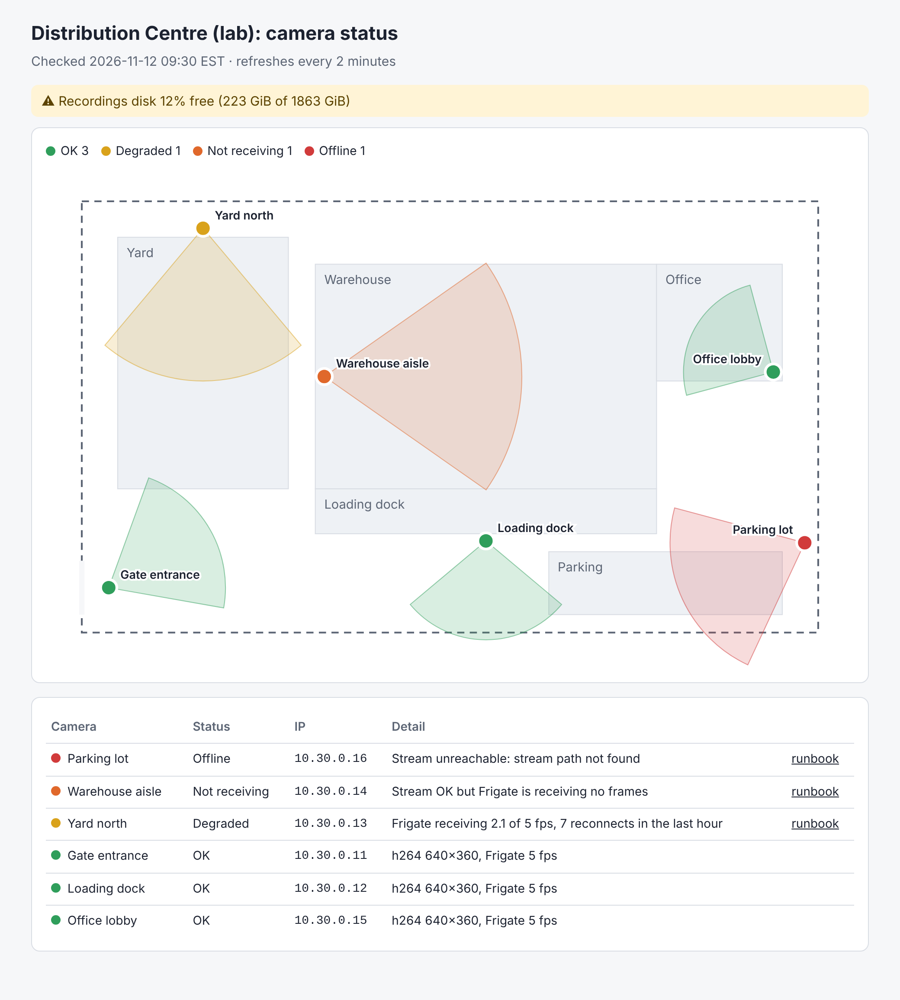
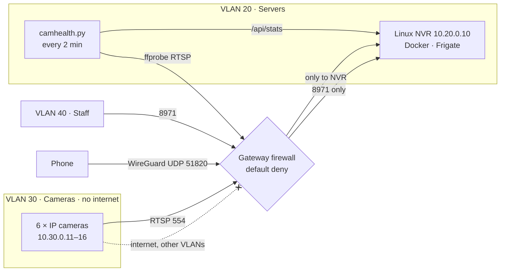

# Video Surveillance & Remote Access Lab

A Linux NVR running **Frigate in Docker**, with IP cameras isolated on their own **VLAN**, remote viewing over
**WireGuard** instead of port forwarding, a **troubleshooting runbook** built around `tcpdump`, `ffprobe` and
firewall logs, and a **Python health check** that finds offline cameras and shows them on a site map.



## What's in it

| Part | Files |
|---|---|
| Frigate NVR: 6 cameras, recording, retention, motion events | [`docker-compose.yml`](docker-compose.yml), [`frigate/config.yml`](frigate/config.yml) |
| Camera simulator: real RTSP streams, no hardware needed | [`sim/mediamtx.yml`](sim/mediamtx.yml), [`frigate/config.sim.yml`](frigate/config.sim.yml) |
| VLAN plan, firewall rules, camera hardening | [`network/network-design.md`](network/network-design.md), [`network/nftables.conf`](network/nftables.conf) |
| WireGuard remote access (split tunnel to the NVR only) | [`network/wireguard/`](network/wireguard/) |
| Troubleshooting runbook | [`docs/runbook.md`](docs/runbook.md) |
| Health check: Frigate API + RTSP probe → site map | [`healthcheck/camhealth.py`](healthcheck/camhealth.py), [`healthcheck/site.yaml`](healthcheck/site.yaml) |

## Design



- **Cameras reach only the NVR.** No internet, no DNS, no access to other VLANs; drops are logged as `CAM-DROP`, which also shows what a camera tries to phone home to.
- **No port forwarding.** The only open port on the internet side is WireGuard's. Remote devices get a split tunnel to `10.20.0.10/32` and the firewall lets them reach only Frigate's authenticated port (8971).
- **Two streams per camera:** the 1080p main stream is recorded; the 640×360, 5 fps substream is used for detection, at about a ninth of the decoding work.
- **Retention:** motion segments 7 days, person/car alerts 30 days, no 24/7 footage by default. Disk use stays proportional to activity, not time.

## Health check

For each camera it checks two things **separately**: can `ffprobe` open the RTSP stream, and is Frigate
actually receiving frames (`/api/stats`)? Comparing them says where the fault is:

| Status | Stream | Frigate | Fault is in | Runbook section |
|---|---|---|---|---|
| OK | opens | receiving | — | — |
| Degraded | opens | < 60% of expected fps, or reconnecting | network quality or NVR load | [stream stutters](docs/runbook.md#stream-stutters-or-drops-frames) |
| Not receiving | opens | 0 fps | Frigate config or credentials | [stream OK, Frigate not receiving](docs/runbook.md#stream-ok-but-frigate-not-receiving) |
| Offline | fails | — | camera, cabling or firewall; ffprobe error says which | [camera offline](docs/runbook.md#camera-offline) |

It also warns when the recordings disk is low. Output: console lines (for journald), `output/status.json`, and
`output/site_map.html` (above). Exit code 0/1/2 for OK/warning/critical, so it works with any monitoring tool.
Runs every 2 minutes from a systemd timer (`healthcheck/systemd/`). Camera passwords are masked in all output.

## Run it

**With the simulator (no cameras needed):**
```bash
cp .env.example .env
FRIGATE_CONFIG=./frigate/config.sim.yml docker compose --profile sim up -d
# Frigate UI: https://localhost:8971 (first login password is printed in: docker logs frigate)
pip install -r healthcheck/requirements.txt
python healthcheck/camhealth.py --rtsp-url 'rtsp://127.0.0.1:8554/{name}/sub'
```
The simulator leaves `parking_lot` out on purpose, so one camera shows as offline.

**With real cameras:** put the cameras on VLAN 30 with the addresses in `frigate/config.yml`, set the viewer
account in `.env`, apply `network/nftables.conf` (or the equivalent rules on your gateway), then `docker compose up -d`.

**Remote access:** set up the server from `network/wireguard/wg0.conf.example`, then per device:
```bash
WG_ENDPOINT=vpn.example.com ./network/wireguard/new-peer.sh phone-rakshit 2     # prints a QR code for the WireGuard app
```

## Tests

```bash
pytest -v tests/               # 19 tests; the integration tests run real RTSP streams from MediaMTX against a mock Frigate API
sudo ./tests/test_network.sh   # nft -c on the firewall rules; generates a real WireGuard peer and parses both configs
python tests/validate_frigate_config.py   # validates both Frigate configs with Frigate 0.18.2's own config model
```

Validating against Frigate's model caught two real errors in this config: the motion-mask format changed in
recent versions, and Frigate rejects a relative coordinate written as `1.000` (it compares the text with
`"1.0"` and treats it as a pixel value), so masks use `0.999`.

## Limitations

- **Frigate's API is mocked in the tests** using the field layout of Frigate 0.18's `/api/stats`. The RTSP side is real (MediaMTX + ffmpeg).
- **The firewall rules are syntax-checked**, not traffic-tested; confirm with the tcpdump steps in the runbook after applying them.
- **CPU detection** is fine for a few cameras; more need an Intel iGPU (OpenVINO) or a Coral.
- **The site map is drawn from coordinates in `site.yaml`**, not from a floor-plan image.

## License

MIT
